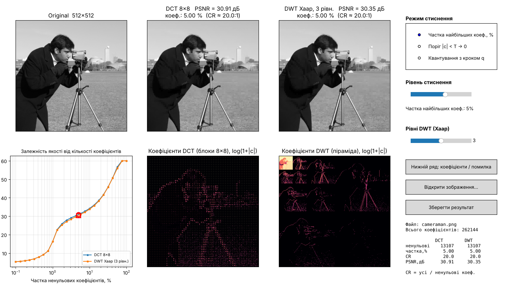
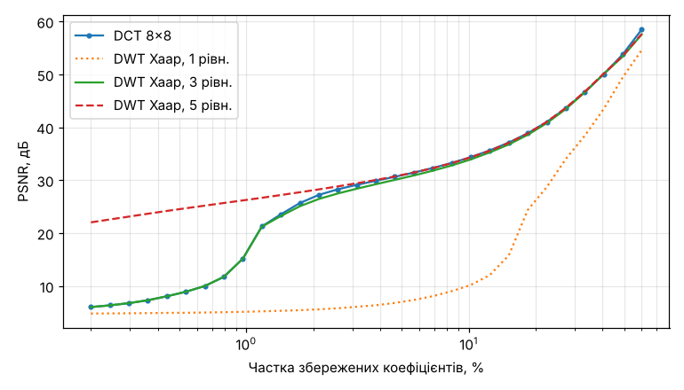

# Лабораторна робота №3 — стиснення зображень з втратами (DCT vs DWT Хаара)

**Дисципліна:** Розробка мультимедійних систем  
**Виконав:** Марченко Данил, 4 курс, група ІПС-42, спеціальність 121 «Інженерія програмного забезпечення»  
КНУ імені Тараса Шевченка, факультет комп’ютерних наук та кібернетики

📄 **Звіт:** [report/ЛР3_Звіт_Марченко.pdf](report/ЛР3_Звіт_Марченко.pdf) ([docx](report/ЛР3_Звіт_Марченко.docx))



## Що реалізовано
- **DCT 8×8 у матричній формі** — `Y = C·X·Cᵀ`, `X = Cᵀ·Y·C` (власна реалізація, `transforms.py`)
- **Багаторівневе перетворення Хаара** через ортонормовану матрицю (1–5 рівнів)
- **3 механізми стиснення:** частка найбільших коефіцієнтів, жорсткий поріг, рівномірне квантування (`lossy.py`)
- **PSNR** і коефіцієнт стиснення (за кількістю ненульових коефіцієнтів)
- **GUI:** Original | DCT | DWT, повзунок рівня стиснення, кількість рівнів DWT, графік PSNR, карти коефіцієнтів / помилок
- Тести коректності: ортонормованість, ідеальне відновлення, рівність Парсеваля, збіг з еталонним DCT

Готові функції DCT/DWT **не використовуються** — NumPy лише для множення матриць.

## Запуск
```bash
python3 -m venv venv && source venv/bin/activate
pip install -r requirements.txt
python test_transforms.py   # перевірка коректності
python app.py               # інтерактивне вікно (cameraman.png)
python app.py photo.jpg     # своє зображення
python experiments.py       # таблиці й графіки -> results/
```

## Файли
| Файл | Призначення |
|---|---|
| `transforms.py` | DCT 8×8 і Хаар (матриці, прямі/обернені перетворення) |
| `lossy.py` | стиснення коефіцієнтів, PSNR, клас `Codec` |
| `app.py` | графічний інтерфейс (matplotlib) |
| `experiments.py` | серія експериментів |
| `test_transforms.py` | тести |
| `results/` | результати експериментів (CSV, графіки) |

## Основні результати (cameraman 512×512, DWT 3 рівні)
| Частка коеф. | CR | PSNR DCT | PSNR DWT |
|---|---|---|---|
| 20 % | 5:1 | 39,70 дБ | 39,44 дБ |
| 10 % | 10:1 | 34,22 дБ | 33,81 дБ |
| 5 % | 20:1 | 30,91 дБ | 30,35 дБ |
| 2 % | 50:1 | 26,83 дБ | 26,09 дБ |



---
© 2026 Марченко Данил, ІПС-42
